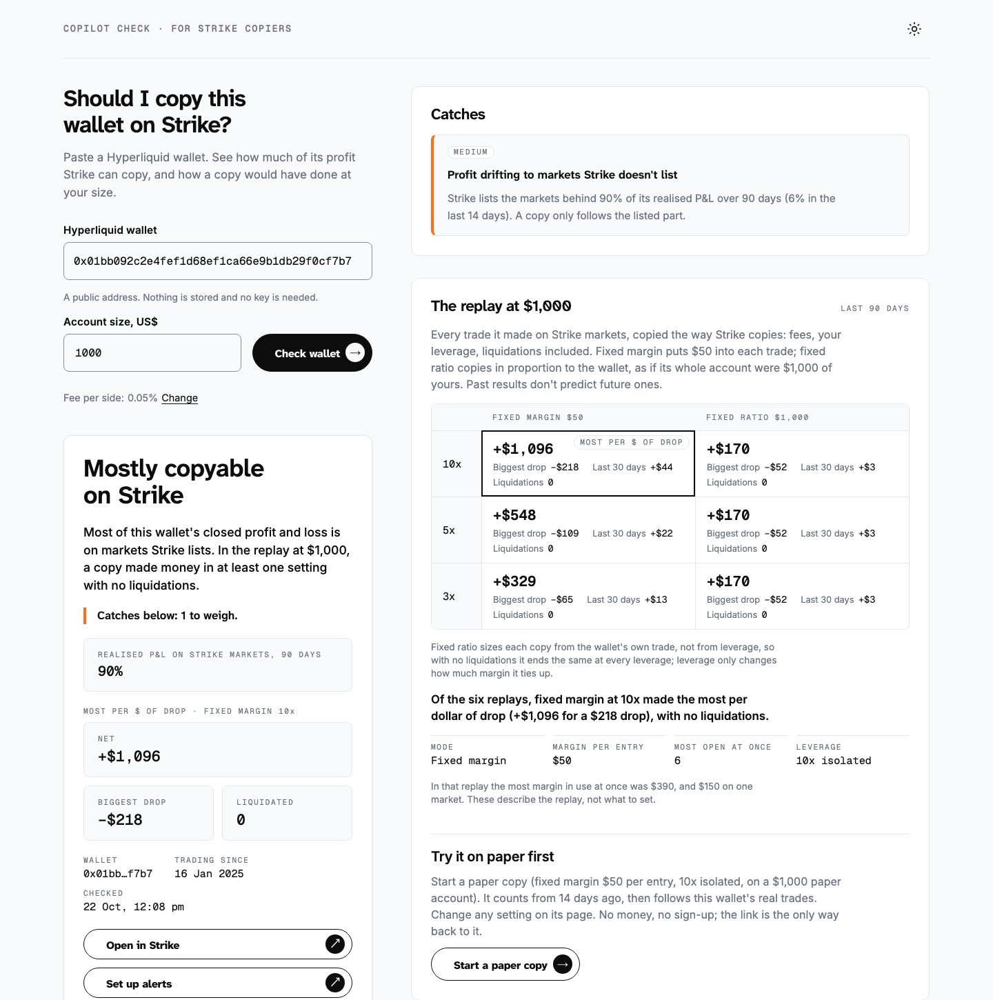
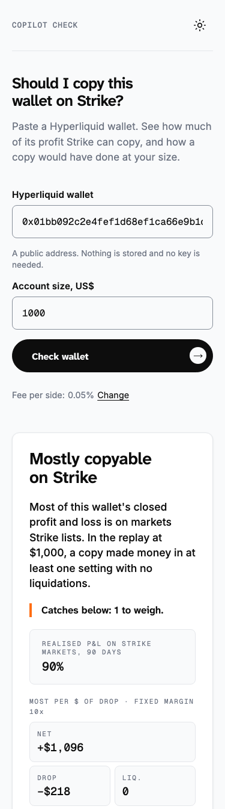
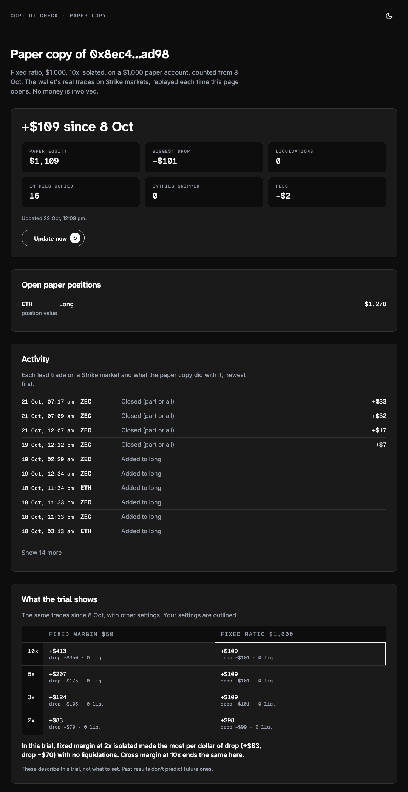

# Copilot Check

Paste a Hyperliquid wallet and see whether it's worth copying on Strike: how much of its profit is on markets Strike lists, what it holds now, the catches in its record, and how a copy would have done at your size. Then paper-copy it with your own settings before risking money.

**Try it:** [strike.benryan.com.au](https://strike.benryan.com.au)

Built during the Strike Finance hackathon (22–24 Oct 2026). Not affiliated with Strike Finance. Not financial advice. Past results don't predict future ones.

**Related tools:** [Copilot Watch](https://github.com/benryandev/copilot-watch) ([Telegram](https://t.me/CopilotWatchBot)) sends Telegram and Discord alerts when a copy needs a look. [Strike Copilot](https://github.com/benryandev/strike-copilot) reviews your Strike account and helps you set copies up, by chatting with Claude on your own computer.

<p> </p>

## What the report shows

- **Verdict:** a short headline and one descriptive sentence, plus the most serious catch.
- **Strike fit:** the share of the wallet's realised P&L (last 90 days, and last 14) that comes from markets Strike lists. A copy can only follow those.
- **What it holds now:** open positions, leverage, distance to liquidation, listed or not.
- **Catches:** wipeouts in its history, high leverage now, close to liquidation on Hyperliquid, young record, profit drifting to unlisted markets, concentration in one coin, large withdrawals, last month's loss.
- **The replay at your size:** every trade the wallet made on a Strike market, copied the way Strike copies, in both copy modes (fixed margin, fixed ratio) at 10x, 5x and 3x, over 90 and 30 days. It uses Strike's fees (0.05% per side by default, editable), Strike's own hourly funding rates, closes 10 bp worse, hourly prices, Strike's margin tiers and liquidations. The page says which setting made the most per dollar of drawdown in the replay, described as a fact about the past, not a setting to use.
- **Month by month:** the wallet's own P&L.

## Paper Copy

From a report, or with `/paper <wallet>` in [Copilot Watch](https://t.me/CopilotWatchBot), start a paper copy with your own settings (mode, amount, leverage, isolated or cross, caps, excluded markets). It is back-dated 14 days so it has numbers straight away, and every time the trial page opens it replays the wallet's real trades since then: paper equity, open positions, each entry copied or skipped (and why), the same period under other settings, and the exact fields to enter in Strike's copy dialog to go live. Trials store only the wallet and settings, and end after 30 days.



## The ecosystem world

[strike.benryan.com.au/ecosystem](https://strike.benryan.com.au/ecosystem/) is a drivable 3D map of Strike's features: nine districts on a ring of dirt roads around Strike HQ, a pad at every feature that opens a sheet with live figures, a timed raceway with a shared leaderboard and the leader's ghost, a yard where every trade on Strike arrives as a crate, and other visitors driving around you as named cars. It is a fan-built map on live data, not affiliated with Strike. It lives in `ecosystem/` and shares nothing with the report above except the design kit.

### How it is built

- **three.js r170, no bundler, no build step.** Twenty-one hand-written ES modules (about 270 KB unminified) loaded straight by the browser under a strict Content Security Policy (`script-src 'self'`, so no inline scripts and no import map; the vendored addons import three by relative path). The only vendored code is three itself, GLTFLoader, and the r170 post-processing addons.
- **The world is generated, not downloaded.** Terrain is an analytic height field (summed hills, flattened under roads and plazas, lifted along the raceway); roads are Catmull-Rom curves swept into ribbons with the terrain sampled underneath; plazas are cobbled with a seamless sett tile painted on a canvas (colour and bump) in world-metre UVs; signs, boards, tickers and labels are canvas textures drawn from the same content file that drives the sheets. Twenty-five low-poly landmark models (HQ, vaults, the arch, the observatory, the car and so on) were made in Blender and arrive as glTF after the first frame; the world is playable before them, with box stand-ins swapped out as each loads.
- **The car.** Arcade physics in one module: throttle, grip that comes in with speed, slope pitch and roll, jumps with a squash on landing, dust from the wheels on dirt, a chase camera that pulls in when a building is behind the car and rises when there is no room. Everything runs on the game's own clock, which stops while a sheet is open.
- **Live data.** Strike's public API for markets, volumes, funding and the figures on each sheet; Strike's public trade stream for the Fill Yard, where each fill becomes a crate sized by its notional that rides a conveyor, falls off the end, tumbles, slides and stacks (a small rigid-ish crate simulation written for the purpose). Nothing is stored about a visitor; the only requests go to Strike and to the two Cloudflare Workers below.
- **The raceway.** Gates crossed in order, splits per checkpoint, and a trace of the lap at ten samples a second. A Worker validates every posted lap: a top-speed ceiling for the whole lap and a looser one per segment (a good line cuts corners), per-sample speed on the trace with rounding slack, one row per name and one per player on the board, a post window per address. The fastest lap's trace is served back as a ghost that drives beside you with its name over it.
- **Live races.** Anyone on the Raceway can press Race; everyone in the world gets a 20 s invite, up to eight cars sit on a staggered grid with the throttle locked, a 3-2-1 runs on the server clock (offset from pings), checkpoints and the finish are reported as the lap timer sees them and the room orders the finish by its own receive time (dead heats within 0.1 s share a place). The lap is still timed line to line in the browser, so a race lap can post to the leaderboard. The race state lives in the room and is persisted across Durable Object evictions; its timers share the room's single alarm with the idle reaper.
- **Sound.** Synthesised in Web Audio, no files: an engine in layers with four virtual gears (block through a soft clip, on-throttle exhaust pulse, firing-rate chug, wobble, gear whine, wind, overrun pops), ground noise by surface, hits by what was hit, cues for pads, laps, countdowns and a new #1, and a quiet ambient chord bed. Starts on the first click; a mute chip and Sound / Music switches, remembered. Silent under automation unless `?sound=1`.
- **Multiplayer presence.** A second Worker with a Durable Object holds one room for the whole world over the WebSocket Hibernation API. Clients send a pose ten times a second while moving and once a second when still; the room fans out snapshots at most every 100 ms; clients interpolate 150 ms behind and snap on teleports. Names are checked for look-alike characters and rude words, duplicates get a number, idle sockets are reaped by an alarm, and a KV key is the kill switch. Cars are built only for the nearest few peers and parked after ten seconds out of range.
- **Rendering.** Three quality tiers (pixel ratio, shadow map size, grass and dust counts, bloom) chosen by pointer type and dropped a step when frames run slow. Bloom is selective by luminance rather than by layer: the scene renders to a half-float target with 4× MSAA, a threshold of 1.05 that lit surfaces and labels stay under, and glow sources scaled to the same brightness whatever their hue. Day has clouds of instanced low-poly puffs that drift with the wind and wrap round the camera; night has a dome of twinkling points and the odd shooting star.
- **The arrival.** A loader that reports the build in five real steps, then a six-second flight from high over HQ that banks in behind the car as it drops onto the road. Any key skips it; it plays once per tab; reduced motion goes straight to the sheet.
- **Phones.** Touch pads, a HUD that collapses to one line, sheets sized for 360 px, no double-tap zoom, landscape handled. The QA harness shoots twelve widths in both themes (360 to 1920, including the quantisation probes at 1001 and 1279) and audits each shot for overlaps, sideways scroll, tap targets under 44 px, contrast against both a black and a white scene, and page errors.

### Run the world locally

```sh
node qa/serve.mjs                          # http://localhost:8080, production headers
node qa/shoot-eco.mjs http://localhost:8080  # 24 screenshots + audits into qa/shots/
node --test qa/peers-unit.mjs qa/race-unit.mjs
```

`?arrive=0` skips the opening flight, `?arrive=1` forces it, `?mp=0` stays out of the multiplayer room, `?sound=0` keeps it silent.

## How it uses Strike

The report runs in the browser against public APIs; there is no server of ours and nothing about a report is stored. Paper Copy stores only the wallet and settings, with Copilot Watch's Worker, for 30 days.

| Need | Source |
|---|---|
| Strike's markets, minimum order size, margin tiers (max leverage and maintenance margin by size) | Strike `GET /v2/markets` |
| Hourly funding rates per market, last 90 days (settled on each copy in the replay; isolated funding comes out of the position's margin) | Strike `GET /stat/v1/stats/coin/history/funding` |
| Strike symbol ↔ Hyperliquid coin (including stocks and commodities on Hyperliquid's `xyz` dex: SKHYNIX, XAU, XAG, WTI, NAS100) | `core/markets.js` |
| The wallet's fills (paged, up to 20,000), positions on both dexes, equity history, deposits and withdrawals, hourly candles | Hyperliquid info API |
| "Open in Strike" | `app.strikefinance.org/public-portfolio/<wallet>?platform=hyperliquid` |

The replay (`core/replay.js`) is a line-for-line port of [Strike Copilot](https://github.com/benryandev/strike-copilot)'s Python replay, and is tested against it: `test/replay-parity.test.js` checks 36 cases on three real wallets (2 windows × 2 modes × 3 leverages) for the same net and drawdown within $5 and the same liquidations, entries and wipeouts.

## Run it locally

```sh
pnpm test            # node --test, no dependencies
node qa/serve.mjs    # http://localhost:8080 with the production security headers
```

`core/` is shared with [Copilot Watch](https://github.com/benryandev/copilot-watch); `pnpm core-hash` updates `core/VERSION`, which Watch checks after copying.

## Limits

- Funding is not modelled; neither is Strike's liquidation fee.
- Up to 20,000 fills and hourly prices for the 12 most-traded markets per check, so a very busy wallet is replayed over 30 days only, and a few markets may be replayed without hourly prices (liquidations there aren't checked). The report says when either happens.
- Hyperliquid rate-limits by IP; a busy moment shows "Hyperliquid is busy. Try again in a minute."

## Privacy and security

No accounts, cookies, analytics or keys. A paper copy stores only the wallet and settings (30 days); a report stores nothing. The Worker keeps daily totals of paper copies started and of visits to Copilot Watch through this site's link, as plain numbers with no wallet or ids. The wallet you paste goes into the URL after `#` (never sent to the server) so a report can be shared. Strict Content Security Policy; all API data is rendered as text. See [SECURITY.md](SECURITY.md).

## Design

Styled with Ben Ryan's design kit (`css/br-*.css`, `fonts/`), copied in before the hackathon window opened as existing brand work; the page's own styles are in `css/app.css` and `css/paper.css`. Fonts: Inter, Geist Mono and Atkinson Hyperlegible Next, each under the SIL Open Font License 1.1 (see `fonts/*-OFL.txt`). The BR. logo is Ben Ryan's mark and isn't covered by the code licence.

## Licence

Code: MIT (see `LICENSE`). Fonts: SIL OFL 1.1.

Built by [Ben Ryan](https://benryan.com.au).
