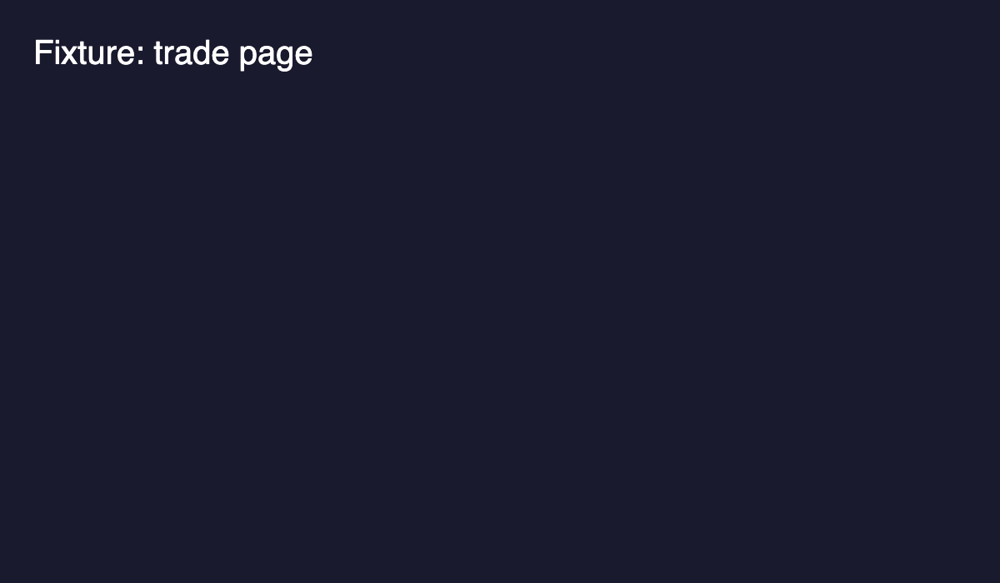

*Not affiliated with Strike. Not financial advice.*

## In one minute

- **What it is:** Strike is an exchange for perps, which are bets on a price going up or down, across crypto, big-name stocks, gold, silver and oil.
- **Who it's for:** traders who want more than crypto in one place, and people who would rather copy an experienced trader than trade themselves.
- **The one thing to know:** perps use leverage, which makes gains and losses bigger. Start small and learn how liquidation works first.

## What is Strike?

**Strike Finance** is a **perpetual futures exchange**. A **perpetual future**, or **perp**, is a contract that follows the price of something, such as Bitcoin or Tesla, without you owning it. You can profit if the price rises, by going **long**, or if it falls, by going **short**.

Strike started on Cardano in 2025. It now runs its own trading engine with an **order book**, the system large exchanges use. Buyers and sellers post the prices they want, and the engine matches them. Your funds sit in smart contracts on the blockchain.

### What can you trade?

Strike lists {{claim:markets-count}} markets. They fall into four groups.

| Type | Examples |
|---|---|
| Crypto | Bitcoin, Ethereum, Solana, XRP, Cardano |
| Stocks | Nvidia, Tesla, Alphabet, Coinbase |
| Indices | S&P 500, Nasdaq-100 |
| Commodities | Gold, silver, WTI crude oil |

Everything sits on one account and one balance. You do not need a separate stock broker to trade Nvidia next to Bitcoin.

### What is copy trading?

**Copy trading** lets Strike place trades on your account whenever a trader you choose makes a trade. You can copy traders on Strike, or any wallet on Hyperliquid, a large exchange where every trade is public. You choose how big each copied trade is, and you can cap how much of your balance it uses.

## Who it's for

- **You trade crypto and want stocks or gold too.** A Bitcoin trade and a gold trade can sit on the same account.
- **You would rather not pick every trade.** You copy a trader whose record you have checked, with limits so one bad run cannot take your whole balance.
- **You are new to trading.** Connect a wallet, deposit a small amount, and learn while the numbers are small. This series walks you through it.

## How to get started

1. Go to **app.strikefinance.org** in a browser, or install the Strike app on Android.
2. **Sign in** by connecting a wallet. Cardano, Ethereum and Solana wallets all work.
3. **Deposit.** Pay by card, or send crypto such as USDC. Coins that move in price are swapped to dollars on arrival. Your balance is always in US dollars.
4. **Look around before you trade.** The Trade page shows the markets and their colour-coded order books; Copy Trading and Earn have their own menus.

## A worked example

*This is an example, not a suggestion.* Say you deposit $100 and open a $100 long on gold with no leverage. If gold rises 5%, your position is worth about $105, less a small trading fee. If gold falls 5%, it is worth about $95.

With leverage, both of those moves get bigger. That is the topic of guide 3.

## Things worth knowing

- **Leverage can liquidate you.** If a leveraged trade moves far enough against you, the exchange closes it and you lose the money behind it. Guide 4 explains how to keep clear of that.
- **Withdrawals have limits.** Strike caps how much can leave in any rolling 1-hour and 24-hour window. Very large withdrawals wait in a delayed queue. Normal-sized withdrawals go straight through.
- **Copying a trader does not copy their results.** Your copy uses your own leverage and size, and it starts from the moment you subscribe. Your results can differ from theirs.

## Questions people ask

### Do I need ADA or a Cardano wallet?

No. An Ethereum or Solana wallet works too, and deposits can be made by card.

### Is Strike only for crypto?

No. Stocks, indices and commodities trade on the same account as Bitcoin.

### Can I copy a trader instead of trading myself?

Yes. Copy trading places a trade on your account whenever the trader you chose makes one, within limits you set.

## How I use it

> **How I use it**
> I do not trade by hand. I copy two traders from Hyperliquid on Strike, one on my main account and one on a sub-account. I check every trader's full history first. My rule: decide your limits before your first copy, not after your first loss.

## Next

- **Next:** What is a perp? (Start here, part 2)
- Then: Long, short and leverage, Liquidation and how to avoid it, Your first trade on Strike.
- Official docs: [Welcome to Strike](https://docs.strikefinance.org/getting-started/welcome)
- Try it: [open Strike](https://app.strikefinance.org/trade/BTC?referralCode=BenRyan) (my referral link, 5% off fees)

*Not financial advice.*

## Fact sources (remove before publishing)

- Perps exchange, started on Cardano (V1 May 2025), V2 order book: docs.strikefinance.org/getting-started/welcome.md (checked 10 Nov 2026).
- Markets count: claim `markets-count` (api.strikefinance.org/v2/markets).
- Withdrawal limits: docs.strikefinance.org/perpetuals/deposits-and-withdrawals/withdrawal-security-and-controls.md (10 Nov 2026).
- Copy trading mechanics: docs.strikefinance.org/perpetuals/copy-trading.md (10 Nov 2026).
